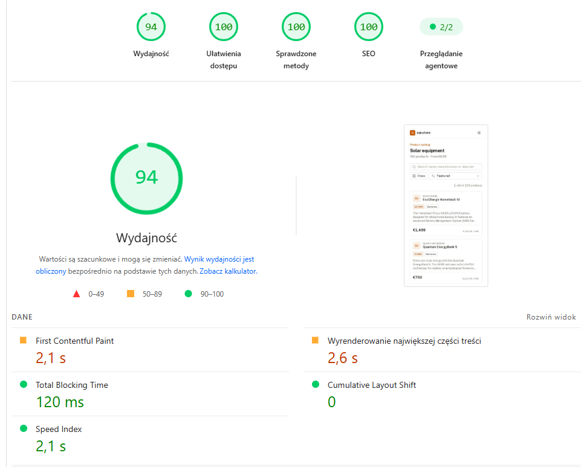
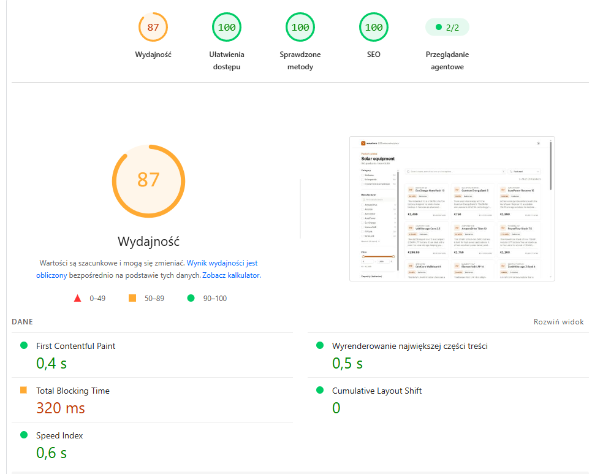

# sun.store – listing produktów

Strona listingu dla 150 produktów z `products.csv`: filtry (kategoria, producent, cena, pojemność kWh, moc W), wyszukiwanie i sortowanie. Filtrowanie odbywa się na serwerze, stan filtrów jest w URL.

Nuxt 4, Vue 3, TypeScript (strict), Nuxt UI 4, Vitest, Playwright.

- Demo: https://sun-store-two.vercel.app
- Repo: https://github.com/tomekos11/sun-store

## 1. Kluczowe decyzje

**Stan filtrów tylko w URL.** Nie ma store'a. Filtry są wyliczane z `route.query`, a każda zmiana filtra to `router.push`. Dzięki temu link z filtrami renderuje się w SSR z właściwymi wynikami, a przycisk wstecz działa bez dodatkowego kodu.

**Jeden parser dla strony i API** (`shared/utils/filters.ts`). Strona przekazuje swoje query do `/api/products` bez zmian, a serwer parsuje je tą samą funkcją. Przykładowy URL:

```
/?q=lfp&category=battery&manufacturer=aurapower,ecocharge&capacity=7.5-&sort=capacity-desc
```

Nieprawidłowe parametry są ignorowane (nie ma błędu 400). Wartości są sortowane, a domyślne pomijane, więc te same filtry zawsze dają ten sam URL. To ważne dla canonical i cache.

**CSV jako server asset Nitro** (`server/assets/products.csv`). Plik jest dołączany do builda serwera, wczytywany raz (`csv-parse`) i trzymany w pamięci razem z indeksem wyszukiwania.

**Cache i region na Vercelu.** HTML zależy tylko od query i pliku CSV, więc każdy URL z filtrami jest cache'owany na CDN do następnego deployu (ISR, klucz cache to lista parametrów filtrów, więc np. `utm_source` go nie rozbija). Funkcja działa we Frankfurcie (`fra1`) zamiast domyślnego Waszyngtonu, bo klienci są w Europie. TTFB spadło z ok. 350 ms do ok. 110 ms.

**Liczniki przy filtrach.** Liczba przy producencie mówi, ile produktów dojdzie po jego zaznaczeniu. Np. przy zaznaczonym EcoCharge obok AuraPower nadal jest 5, a nie 0. Kilku producentów naraz poszerza wyniki, a każdy kolejny rodzaj filtra (cena, kategoria) je zawęża. Opcje, które dałyby 0 wyników, są wyszarzone.

**Cena za kWh / za W.** Instalatorzy porównują baterie w €/kWh, a panele w €/W. Pokazuję tę wartość na karcie i można po niej sortować, ale tylko gdy wybrany jest jeden typ produktu, bo €/kWh i €/W się nie porównuje.

**Filtry pojemności i mocy** pojawiają się tylko wtedy, gdy wybrane kategorie mogą je mieć. Ustawienie zakresu kWh wyklucza produkty bez pojemności.

**Historia przeglądarki:**
- checkbox, sortowanie i strona to osobne wpisy w historii,
- slider aktualizuje URL dopiero po puszczeniu,
- wyszukiwarka ma debounce 300 ms; pierwsza zmiana robi `push`, kolejne w ciągu 1,5 s `replace`, więc „wstecz” nie cofa się litera po literze.

**Wyszukiwanie:** MiniSearch z indeksem budowanym raz przy starcie. Wszystkie słowa muszą pasować, nazwa ma większą wagę niż producent i opis, działa wyszukiwanie po prefiksie („homev”) i tolerancja literówek dla dłuższych słów („homevalt”). Do tego kilka synonimów (`lfp`/`lifepo4`), prosta obsługa liczby mnogiej i ignorowanie polskich znaków. Facety, sortowanie i paginacja są po mojej stronie, bo zależą od logiki katalogu. Trafienia są podświetlane na kartach.

**SEO:**
- `title`, `description`, `robots`, `canonical` i `og:*` zależą od filtrów (`shared/utils/seo.ts`), a H1 jest budowany z tej samej logiki;
- JSON-LD: `BreadcrumbList` + `CollectionPage`.
- JSON-LD sprawdziłem w Rich Results Test i w walidatorze schema.org: 0 błędów, 0 ostrzeżeń;
- `/sitemap.xml` zawiera tylko strony do indeksowania, a `/robots.txt` odsyła do sitemapy.

**Inne:**
- UI po angielsku, bo dane są po angielsku;
- ceny zakładam w EUR, bo CSV nie podaje waluty;
- w jasnym motywie kolor główny to amber-700, bo amber-500 nie przechodził kontrastu.

## 2. Pozyskanie kWh / W

Kod: `server/lib/specs.ts`, testy: `tests/unit/specs.test.ts`.

Wartość biorę z opisu i sprawdzam ją z numerem modelu w nazwie:

1. Z opisu wyciągam wszystkie wystąpienia liczby z jednostką i przeliczam je na kWh albo W.
2. Z nazwy biorę ostatnią samodzielną liczbę (`HomeVault 13.5`, `Prime 450`).
3. Jeśli któraś wartość z opisu zgadza się z nazwą, wybieram ją. Jeśli nie, biorę pierwszą wartość z opisu. Jeśli opis nic nie zawiera, używam liczby z nazwy.

Samo pierwsze dopasowanie nie wystarcza, bo opisy często mają kilka wartości.

Obsłużone przypadki:
- `10kWh`, `5 kWh`, `13.5 KWH` (spacja, wielkość liter),
- `2500Wh` → 2.5 kWh, `0.46 kWp` → 460 W,
- `7,5 kWh` → 7.5, ale `6,000` → 6000 (przecinek i trzy cyfry to separator tysięcy),
- `Wh`, `V`, `A`, `Pa` nie są czytane jako moc,
- liczby sklejone z tekstem (`MC4`, `15A`, `2-1`, `10-pack`) są pomijane,
- wartości spoza sensownego zakresu są odrzucane,
- specyfikacja zależy od kategorii, więc np. „5 kW output” w opisie baterii nie trafi do filtra mocy paneli.

## 3. Indeksowanie kombinacji filtrów

Indeksowałbym tylko kombinacje, które ludzie faktycznie wyszukują (kategoria, kategoria + jeden producent), docelowo jako osobne ścieżki typu `/batteries/ecocharge` w sitemapie. Reszta (kilka wartości naraz, zakresy, wyszukiwanie, sortowanie) dostaje `noindex, follow`, żeby nie tworzyć tysięcy prawie identycznych stron. Kolejne kombinacje, np. „baterie 10 kWh”, dodawałbym na podstawie danych z Search Console.

## 4. Czego nie zrobiłem i co dalej

Świadomie pominąłem:
- strony produktu
- bazę danych i zewnętrzny silnik wyszukiwania
- i18n i waluty: formatowanie jest w jednym miejscu (`shared/utils/format.ts`);

Dalej zrobiłbym:
1. ścieżki SEO dla kategorii i producentów,
2. zbieranie wyszukiwań bez wyników i popularnych kombinacji filtrów,
3. filtry po chemii baterii (LFP/NMC) i typie ogniwa, wyciągane z opisu tak jak kWh/W,
4. testy wizualne w e2e.

## 5. Lighthouse

PageSpeed Insights na wdrożeniu (https://sun-store-two.vercel.app), 29.10.2026.

Mobile:



Desktop:



Accessibility, Best Practices i SEO mają stale 100. Performance w PSI waha się między uruchomieniami (mobile 86–94, desktop 72–87). Lokalnie (`npm run lighthouse <url>`) ten sam deploy ma 90–96 na mobile i 100 na desktopie, więc różnica wynika głównie z obciążenia serwerów PSI. Strony z filtrami z długiego ogona mają w SEO mniej, bo celowo dostają `noindex`.

Co poprawiłem po pomiarach:
- włączyłem `componentDetection` w Nuxt UI, co zmniejszyło CSS z 211 KB do 96 KB,
- ikony są w bundlu, nie pobierane w runtime,
- mobilny panel filtrów jest ładowany dopiero przy otwarciu,
- dodałem `<main>` i poprawiłem kontrast (w tym badge'a w jasnym motywie, który wyszedł dopiero w PSI),
- cache HTML na CDN i region `fra1` (patrz pkt 1),
- sprawdziłem też leniwą hydrację panelu filtrów na mobile, ale w pomiarze TBT wzrósł ze 120 do ok. 400 ms, więc to wycofałem.

## 6. Jak korzystałem z AI

Pracowałem z Claude Code oraz w mniejszym stopniu z GPT.

Z AI korzystałem kilkuetapowo:
- na początek pomoc przy zrozumieniu danych specyficznych dla dziedziny (kWh, Wp, €/W, LFP/NMC)
- wygenerowałem kilka pomysłów jak zabrać się do pracy i wybrałem podejście
- wygenerowałem częściowo kod oraz testy
- poprawiałem wiele aspektów, które AI zrobił w sposób ułomny

Poprawiłem:
- parser CSV i wyszukiwanie - AI zaproponował ręczne parsowanie, ja zmieniłem na bibliotekę. Własny kod tylko dokłada utrzymania.
- tolerancję literówek - fuzzy od 6 znaków
- range filter (slider) - uchwyty na krańcach zakresu były ucinane przez przewijany panel filtrów
- sposób filtrownaia -> Nuxt przy każdym kliknięciu filtra najpierw pobierał _payload.json co robiło spore opóźnienie
- kontrast – lokalny Lighthouse mierzył tylko ciemny motyw, za słaby kontrast badge'a w jasnym wyszedł dopiero w PageSpeed Insights na wdrożeniu,
- styl kodu – AI pisało rozbudowane komentarze nad każdą funkcją, skróciłem je do miejsc, gdzie kod nie jest oczywisty; kolejność bloków w komponentach wymusiłem regułą ESLint.

## 7. Czas

Zadanie zajęło mi ok 3-3.5h. Było robione partiami, ponieważ ostatnio miałem ciężki czas związany z śmiercią bliskiej osoby.